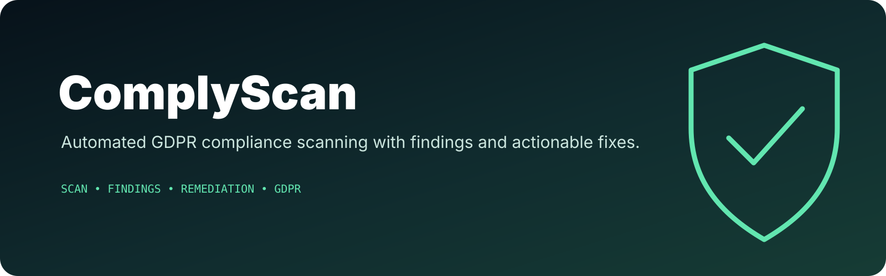

<p align="center">
  
</p>

# ComplyScan — GDPR Compliance Checker

Automated GDPR compliance scanning: enter a URL and receive a report with findings and fix suggestions.

## Tech Stack

- **Framework:** Next.js 15 (App Router)
- **Language:** TypeScript
- **Styling:** Tailwind CSS
- **Payments:** Stripe (subscriptions + one-time credits)
- **Auth:** Session cookie + password/passkey + recovery codes

## Authentication and Checkout Flow

- Checkout is **auth-gated**: users must be logged in before Stripe session creation.
- Access is **cookie-only** (`session` HttpOnly cookie).
- Legacy token URL flow (`?token=...`) and email-link login are removed.
- Password recovery uses one-time recovery codes (no email delivery).

## Setup

```bash
npm install
cp .env.local.example .env.local
npm run dev
```

Open [http://localhost:3000](http://localhost:3000).

## Available Scripts

| Command | Description |
|---------|-------------|
| `npm run dev` | Start development server |
| `npm run build` | Build for production |
| `npm run start` | Start production server |
| `npm run lint` | Run ESLint |
| `npm test` | Run tests |
| `npm run test:coverage` | Run tests with coverage |
